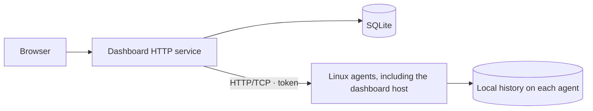

# homelab-dashboard

**English** · [Русский](README.ru.md)

A home page for your homelab applications and a dashboard for monitoring home servers: CPU, GPU, memory, storage, SMART health, and network traffic.

**Status:** early development. APIs, configuration, and installation may change. Intended for trusted LAN/VPN environments; built-in TLS is not available yet. The interface and detailed documentation are currently in Russian.

[Documentation (Russian)](docs/README.md) · [CI checks](https://github.com/nikitakiselev/homelab-dashboard/actions/workflows/checks.yml) · [Report an issue](https://github.com/nikitakiselev/homelab-dashboard/issues)

## Run the dashboard with Docker

Requirements: Docker and Docker Compose v2 with `up --wait`. The prebuilt `ghcr.io/nikitakiselev/homelab-dashboard` image supports Linux amd64/arm64 and can be pulled without a registry login. Python, Node.js and source builds are not needed on the server.

**1. Download the configuration into a dedicated directory:**

```sh
mkdir -p homelab-dashboard
cd homelab-dashboard
curl -fsSLO https://raw.githubusercontent.com/nikitakiselev/homelab-dashboard/main/compose.yaml
curl -fsSL https://raw.githubusercontent.com/nikitakiselev/homelab-dashboard/main/.env.example -o .env
chmod 600 .env
```

**2. Generate a dashboard login token:**

```sh
openssl rand -hex 32
```

Paste the result into `HOMELAB_DASHBOARD_TOKEN=` in `.env`. Other settings:

- `HOMELAB_DASHBOARD_IMAGE=ghcr.io/nikitakiselev/homelab-dashboard:stable` follows the stable image; use `:0.1.0` to pin a release.
- `HOMELAB_DASHBOARD_BIND=127.0.0.1` allows local access only. Use the host's LAN address or `0.0.0.0` for LAN access.
- `HOMELAB_DASHBOARD_PORT=8080` sets the dashboard port.
- `HOMELAB_DASHBOARD_RETENTION_DAYS=90` sets history retention.

**3. Start the dashboard:**

```sh
docker compose pull
docker compose up -d --wait
docker compose ps
```

Open `http://127.0.0.1:8080`, or `http://<server-IP>:8080` if LAN access is enabled, and sign in with your token. Install agents separately as described below. When adding an agent on the Docker host, use its LAN address: `127.0.0.1` inside the container refers to the container itself.

To open the dashboard without signing in from your home network, add this to `.env`:

```dotenv
HOMELAB_DASHBOARD_TRUSTED_NETWORKS=192.168.50.0/24
```

Replace the example with your subnet. All its devices receive full access without a token; other clients still need one. Multiple IPs/CIDRs can be comma-separated; the default is empty. Apply changes with `docker compose up -d --wait`. Existing installations also need the updated `compose.yaml` to pass this setting into the container. See [Docker/proxy limitations (Russian)](docs/docker.md#вход-без-токена-в-домашней-сети).

The running version is displayed in the UI. SQLite lives in the persistent `homelab-dashboard_dashboard-data` volume, which should reside on an SSD. Keep `.env` private. Do not run `docker compose down -v` if you want to retain data.

### Updates

Run from the same directory containing `compose.yaml` and `.env`:

```sh
docker compose exec -T dashboard python -m homelab.server.backup
docker compose pull
docker compose up -d --wait
docker compose ps
```

The first command creates a consistent SQLite snapshot in `/data/backups/`. With `:stable`, `pull` retrieves the new stable image; if a release is pinned, edit its tag in `.env` first. History, registered servers and agent credentials remain in the volume; deployment settings remain in `.env`. Periodically copy backups to separate storage:

```sh
docker compose cp dashboard:/data/backups ./backups
```

### Rollback and diagnostics

Set `HOMELAB_DASHBOARD_IMAGE` in `.env` to the previous release tag, then run `docker compose pull` and `docker compose up -d --wait`. Image rollback preserves the current database. Before an incompatible migration, follow the release notes and keep the matching database backup. `up --wait` checks health but does not roll back automatically.

```sh
docker compose logs --tail=100 dashboard
```

When moving an existing systemd installation, migrate its SQLite database and token first: see [migration details (Russian)](docs/docker.md#переход-с-systemd). Never run both installations against the same database simultaneously.

## Features

- Compact home application grid with search, local icons, editable links and persistent ordering across the entire list. Monitoring remains available at `/overview`.
- Separate local/external addresses; globe badges distinguish owner-confirmed external access from an unverified address. See [catalogue and import details (Russian)](docs/development.md#каталог-приложений).
- Independent dashboard and Linux agent services, with separate configuration, credentials, databases, and updates.
- Standalone Go agents for Linux x86_64/ARM64; no Python or Go toolchain needed on agent hosts.
- Connect each Linux host using an IP address and token, including the host running the dashboard.
- CPU, memory, supported GPUs, uptime, and host availability.
- HDD/SSD/NVMe capacity and disk I/O history; automatic SATA/ATA HDD power-state metrics with sleeping/rotating indicators, automatic NVMe SMART, and opt-in daily ATA SMART snapshots during observed I/O for explicitly selected direct SATA disks. Cached readings include timestamps; HDD filesystem usage may be unavailable or stale.
- Dedicated server pages with CPU, memory, GPU, network, and disk I/O history for 24 hours, 7 days, 30 days, or 90 days.
- Overview network chart compares all hosts: click a host in the legend to isolate it, click again to restore all, or Ctrl/Command/Shift-click to select multiple hosts. Solid lines show received traffic; dashed lines show sent traffic.
- Agents retain history locally and synchronize it after the central service reconnects.
- YAML configuration for collection intervals, network interfaces, and history retention.

## Linux agent installation and systemd alternative

Docker is the recommended dashboard deployment; see above. The automatic installer targets Debian 12+ and Ubuntu 22.04+ with a running systemd instance. Supported architectures are x86_64 and ARM64. Inside a container, the collector sees resources available to that container; install an agent on the host to monitor physical hardware.

**Alternative dashboard installation from source with systemd:**

```sh
curl -fsSL https://raw.githubusercontent.com/nikitakiselev/homelab-dashboard/main/install.sh | sudo sh
```

**Agent service, on each monitored Linux host:**

```sh
curl -fsSL https://raw.githubusercontent.com/nikitakiselev/homelab-dashboard/main/install.sh | sudo sh -s -- --agent
```

The installer checks the system, installs dependencies, configures automatic startup, and verifies the HTTP API. For the central service, it also builds the interface. It prints the address and access token when finished. Running it again updates the code while preserving configuration and SQLite history. If the updated central service fails its health check, the installer restores the previous code and service configuration.

Agents listen on `127.0.0.1:9108` by default. For a remote dashboard (including a bridge container), explicitly set `server.bind` in `/etc/homelab/agent.yaml` to the agent host's LAN/VPN address and run `sudo homelab-agent restart`. Allow access only from the dashboard; do not expose the HTTP API to the internet. Upgrades preserve existing YAML, so change an old `bind: 0.0.0.0` manually.

After installing an agent, click **«Добавить сервер»** in the dashboard and enter its IP address and the token printed by the installer. To show these details again, run `sudo homelab-agent connection-info` on the agent host. Agents do not need Python, Node.js, or frontend files. Use `sudo homelab-agent upgrade` to update an installed agent with API verification and rollback.

Details (Russian): [installation and updates](docs/installation.md) · [YAML configuration](docs/configuration.md).

## Local development

Requirements: Ubuntu 22.04+ or Debian 12+, Python 3.10+, Node.js 22+, and npm. From a cloned repository:

```sh
python3 -m venv .venv
. .venv/bin/activate
python3 -m pip install -r requirements.txt
npm ci
npm run build
python3 -m homelab.server
```

Open [localhost:8080](http://127.0.0.1:8080). The dashboard only displays explicitly registered agents. To monitor its own Linux host, install the agent separately and register it at `127.0.0.1:9108`. On macOS, only the dashboard runs. Add `--demo` to display explicitly labeled synthetic data alongside real hosts.

## Architecture



[Detailed architecture (Russian)](docs/architecture.md) · [metrics and limitations (Russian)](docs/metrics.md).

## Documentation

Detailed documentation is currently available in Russian:

- [Docker deployment, updates, backups and migration](docs/docker.md)
- [Installation, updates, and backups](docs/installation.md)
- [Uninstalling and removing data](docs/uninstall.md)
- [Collector configuration](docs/configuration.md)
- [Development and checks](docs/development.md)
- [Architecture and component boundaries](docs/architecture.md)
- [Metrics, compatibility, and limitations](docs/metrics.md)

## Support and contributing

Use [GitHub Issues](https://github.com/nikitakiselev/homelab-dashboard/issues) for bugs and feature requests. See [CONTRIBUTING.md (Russian)](CONTRIBUTING.md) for the contribution workflow and [SECURITY.md (Russian)](SECURITY.md) for vulnerability reporting.

Maintained by [Nikita Kiselev](https://github.com/nikitakiselev). Community guidelines are in [CODE_OF_CONDUCT.md (Russian)](CODE_OF_CONDUCT.md).

## License

A license has not been selected; there is no `LICENSE` file yet. The project is not currently licensed as open source. A license will be added following the owner's decision.
