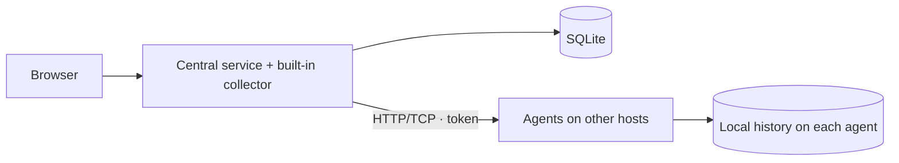

# homelab-dashboard

**English** · [Русский](README.ru.md)

A dashboard for monitoring home servers: CPU, GPU, memory, storage, SMART health, and network traffic.

**Status:** early development. APIs, configuration, and installation may change. Intended for trusted LAN/VPN environments; built-in TLS is not available yet. The interface and detailed documentation are currently in Russian.

[Documentation (Russian)](docs/README.md) · [CI checks](https://github.com/nikitakiselev/homelab-dashboard/actions/workflows/checks.yml) · [Report an issue](https://github.com/nikitakiselev/homelab-dashboard/issues)

## Features

- Central service with a built-in collector: a single computer needs no separate agent.
- Standalone Go agents for Linux x86_64/ARM64; no Python or Go toolchain needed on agent hosts.
- Connect additional Linux hosts using an IP address and token.
- CPU, memory, supported GPUs, uptime, and host availability.
- HDD/SSD/NVMe capacity, used space, temperature, and SMART health.
- Network receive/transmit rates and charts covering 24 hours or 90 days.
- Agents retain history locally and synchronize it after the central service reconnects.
- YAML configuration for collection intervals, network interfaces, and history retention.

## Installation

The automatic installer targets Debian 12+ and Ubuntu 22.04+ with a running systemd instance. Supported architectures are x86_64 and ARM64. Inside a container, the collector sees resources available to that container; install an agent on the host to monitor physical hardware.

**Central service with the built-in collector:**

```sh
curl -fsSL https://raw.githubusercontent.com/nikitakiselev/homelab-dashboard/main/install.sh | sudo sh
```

**Agent only, on another Linux machine:**

```sh
curl -fsSL https://raw.githubusercontent.com/nikitakiselev/homelab-dashboard/main/install.sh | sudo sh -s -- --agent
```

The installer checks the system, installs dependencies, configures automatic startup, and verifies the HTTP API. For the central service, it also builds the interface. It prints the address and access token when finished. Running it again updates the code while preserving configuration and SQLite history. If the updated central service fails its health check, the installer restores the previous code and service configuration.

After installing an agent, click **«Добавить сервер»** in the dashboard and enter its IP address and the token printed by the installer. Agents do not need Python, Node.js, or frontend files. Use `sudo homelab-agent upgrade` to update an installed agent with API verification and rollback.

Details (Russian): [installation and updates](docs/installation.md) · [YAML configuration](docs/configuration.md).

## Local development

Requirements: Ubuntu 22.04+ or Debian 12+, Python 3.10+, Node.js 22+, and npm. From a cloned repository:

```sh
python3 -m venv .venv
. .venv/bin/activate
python3 -m pip install -r requirements.txt
npm ci
npm run build
python3 -m homelab.server
```

Open [localhost:8080](http://127.0.0.1:8080). The computer running the central service appears automatically. Add `--demo` to display explicitly labeled synthetic data alongside real hosts.

## Architecture



[Detailed architecture (Russian)](docs/architecture.md) · [metrics and limitations (Russian)](docs/metrics.md).

## Documentation

Detailed documentation is currently available in Russian:

- [Installation, updates, and backups](docs/installation.md)
- [Uninstalling and removing data](docs/uninstall.md)
- [Collector configuration](docs/configuration.md)
- [Development and checks](docs/development.md)
- [Architecture and component boundaries](docs/architecture.md)
- [Metrics, compatibility, and limitations](docs/metrics.md)

## Support and contributing

Use [GitHub Issues](https://github.com/nikitakiselev/homelab-dashboard/issues) for bugs and feature requests. See [CONTRIBUTING.md (Russian)](CONTRIBUTING.md) for the contribution workflow and [SECURITY.md (Russian)](SECURITY.md) for vulnerability reporting.

Maintained by [Nikita Kiselev](https://github.com/nikitakiselev). Community guidelines are in [CODE_OF_CONDUCT.md (Russian)](CODE_OF_CONDUCT.md).

## License

A license has not been selected; there is no `LICENSE` file yet. The project is not currently licensed as open source. A license will be added following the owner's decision.
