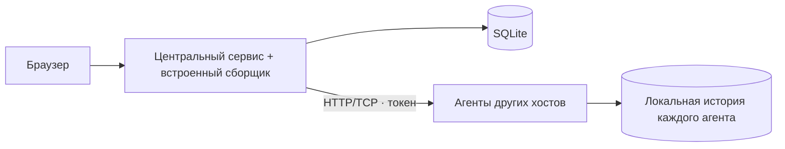

# homelab-dashboard

[English](README.md) · **Русский**

Дашборд для мониторинга домашних серверов: CPU, GPU, память, накопители, SMART и сеть.

**Статус:** ранняя разработка. API, конфигурация и установка могут меняться. Проект предназначен для доверенной LAN/VPN; встроенного TLS пока нет.

[Документация](docs/README.md) · [Проверки CI](https://github.com/nikitakiselev/homelab-dashboard/actions/workflows/checks.yml) · [Сообщить об ошибке](https://github.com/nikitakiselev/homelab-dashboard/issues)

## Возможности

- Центральный сервис со встроенным сборщиком: для одного компьютера отдельный агент не нужен.
- Отдельные Go-агенты для Linux x86_64/ARM64 без Python и Go-компилятора на хосте.
- Добавление других Linux-хостов по IP и токену.
- CPU, память, поддерживаемые GPU, uptime и доступность машин.
- HDD/SSD/NVMe: ёмкость, занятое пространство, температура и SMART.
- Приём и передача по сети, графики за сутки и 90 дней.
- История хранится на агенте и догружается после отключения центрального сервиса.
- YAML-конфиг для интервалов сбора, интерфейсов и хранения истории.

## Установка

Автоматический установщик рассчитан на Debian 12+ и Ubuntu 22.04+ с работающим systemd. Поддерживаются x86_64 и ARM64. При установке в контейнер сборщик видит доступные контейнеру ресурсы; для мониторинга физического оборудования агент устанавливается на хост.

**Центральный сервис со встроенным сборщиком:**

```sh
curl -fsSL https://raw.githubusercontent.com/nikitakiselev/homelab-dashboard/main/install.sh | sudo sh
```

**Только агент на другой Linux-машине:**

```sh
curl -fsSL https://raw.githubusercontent.com/nikitakiselev/homelab-dashboard/main/install.sh | sudo sh -s -- --agent
```

Установщик проверяет систему, устанавливает зависимости, настраивает автозапуск и проверяет HTTP API. Для центрального сервиса он также собирает интерфейс. В конце выводятся адрес и токен доступа. Повторный запуск обновляет код, сохраняя настройки и SQLite-историю. Если новый центральный сервис не проходит проверку, восстанавливается предыдущая версия кода и службы.

После установки агента в дашборде нажмите **«Добавить сервер»**, введите его IP и выведенный токен. Python, Node.js и frontend на агенте не нужны. Обновление агента с проверкой API и откатом: `sudo homelab-agent upgrade`.

Подробности: [установка и обновление](docs/installation.md) · [настройка YAML](docs/configuration.md).

## Локальный запуск

Требования: Ubuntu 22.04+ или Debian 12+, Python 3.10+, Node.js 22+ и npm. Из клона репозитория:

```sh
python3 -m venv .venv
. .venv/bin/activate
python3 -m pip install -r requirements.txt
npm ci
npm run build
python3 -m homelab.server
```

Откройте [localhost:8080](http://127.0.0.1:8080). Компьютер, на котором запущен центральный сервис, появится автоматически. Флаг `--demo` дополнительно показывает явно помеченные синтетические данные.

## Архитектура



[Подробная архитектура](docs/architecture.md) · [метрики и ограничения](docs/metrics.md).

## Документация

- [Установка, обновление и резервирование](docs/installation.md)
- [Удаление и очистка данных](docs/uninstall.md)
- [Конфигурация сборщиков](docs/configuration.md)
- [Разработка и проверки](docs/development.md)
- [Архитектура и границы компонентов](docs/architecture.md)
- [Метрики, совместимость и ограничения](docs/metrics.md)

## Помощь и участие

Ошибки и предложения — через [GitHub Issues](https://github.com/nikitakiselev/homelab-dashboard/issues). Порядок подготовки изменений описан в [CONTRIBUTING.md](CONTRIBUTING.md). Для сообщений об уязвимостях используйте [SECURITY.md](SECURITY.md).

Проект поддерживает [Никита Киселёв](https://github.com/nikitakiselev). Правила общения — в [CODE_OF_CONDUCT.md](CODE_OF_CONDUCT.md).

## Лицензия

Лицензия пока не выбрана; файла `LICENSE` нет. Проект ещё не оформлен как open source. Лицензия будет добавлена отдельным решением владельца.
