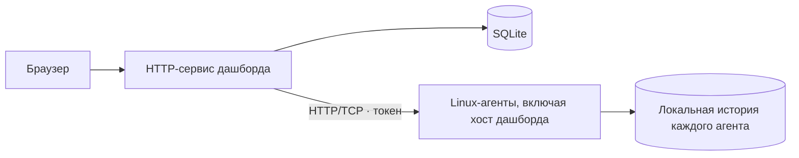

# homelab-dashboard

[English](README.md) · **Русский**

Дашборд для мониторинга домашних серверов: CPU, GPU, память, накопители, SMART и сеть.

**Статус:** ранняя разработка. API, конфигурация и установка могут меняться. Проект предназначен для доверенной LAN/VPN; встроенного TLS пока нет.

[Документация](docs/README.md) · [Проверки CI](https://github.com/nikitakiselev/homelab-dashboard/actions/workflows/checks.yml) · [Сообщить об ошибке](https://github.com/nikitakiselev/homelab-dashboard/issues)

## Запуск дашборда через Docker

Нужны Docker и Docker Compose v2 с поддержкой `up --wait`. Готовый образ `ghcr.io/nikitakiselev/homelab-dashboard` доступен для Linux amd64/arm64 без авторизации в registry. На сервере не нужны Python, Node.js или сборка исходников.

**1. Скачайте конфигурацию в отдельный каталог:**

```sh
mkdir -p homelab-dashboard
cd homelab-dashboard
curl -fsSLO https://raw.githubusercontent.com/nikitakiselev/homelab-dashboard/main/compose.yaml
curl -fsSL https://raw.githubusercontent.com/nikitakiselev/homelab-dashboard/main/.env.example -o .env
chmod 600 .env
```

**2. Создайте токен входа:**

```sh
openssl rand -hex 32
```

Вставьте результат в строку `HOMELAB_DASHBOARD_TOKEN=` файла `.env`. Остальные настройки:

- `HOMELAB_DASHBOARD_IMAGE=ghcr.io/nikitakiselev/homelab-dashboard:stable` — последний стабильный образ; `:0.1.0` закрепляет конкретную версию.
- `HOMELAB_DASHBOARD_BIND=127.0.0.1` — доступ только с этой машины. Для LAN задайте LAN-адрес хоста либо `0.0.0.0`.
- `HOMELAB_DASHBOARD_PORT=8080` — порт дашборда.
- `HOMELAB_DASHBOARD_RETENTION_DAYS=90` — срок хранения истории.

**3. Запустите дашборд:**

```sh
docker compose pull
docker compose up -d --wait
docker compose ps
```

Откройте `http://127.0.0.1:8080` или, если включили LAN-доступ, `http://<IP-сервера>:8080`. Для входа используйте созданный токен. Агенты устанавливаются отдельно — инструкция ниже. При добавлении агента на хосте Docker используйте LAN-адрес хоста: `127.0.0.1` внутри контейнера относится к самому контейнеру.

Вход без токена из домашней сети можно включить одной строкой в `.env`:

```dotenv
HOMELAB_DASHBOARD_TRUSTED_NETWORKS=192.168.50.0/24
```

Замените пример своей подсетью. Все устройства из неё получают полный доступ без входа; для остальных нужен токен. Можно перечислить несколько IP/CIDR через запятую. По умолчанию список пуст. После изменения выполните `docker compose up -d --wait`; при обновлении со старой установки скачайте также новый `compose.yaml`, чтобы переменная передавалась контейнеру. Подробности и ограничения Docker/прокси — в [инструкции](docs/docker.md#вход-без-токена-в-домашней-сети).

Версия дашборда отображается в UI. SQLite хранится в постоянном volume `homelab-dashboard_dashboard-data`, который должен находиться на SSD. `.env` содержит токен: храните его приватно. Не выполняйте `docker compose down -v`, если хотите сохранить данные.

### Обновление

Из того же каталога с `compose.yaml` и `.env`:

```sh
docker compose exec -T dashboard python -m homelab.server.backup
docker compose pull
docker compose up -d --wait
docker compose ps
```

Первая команда сохраняет согласованную копию SQLite в `/data/backups/`. При `:stable` будет загружен новый стабильный образ; если закреплён конкретный тег, сначала измените его в `.env`. История, подключённые серверы и токены сохраняются в volume, настройки — в `.env`. Копии из того же volume периодически сохраняйте на отдельное хранилище:

```sh
docker compose cp dashboard:/data/backups ./backups
```

### Откат и диагностика

Укажите прежний тег в `HOMELAB_DASHBOARD_IMAGE` внутри `.env`, затем повторите `docker compose pull` и `docker compose up -d --wait`. Откат образа сохраняет текущую базу; перед несовместимой миграцией следуйте release notes и используйте соответствующую резервную копию. `up --wait` проверяет health, но не откатывает образ автоматически.

```sh
docker compose logs --tail=100 dashboard
```

При переходе со старой systemd-установки сначала перенесите существующие SQLite и токен: [миграция и подробности Docker](docs/docker.md#переход-с-systemd). Не запускайте две установки с одной базой одновременно.

## Возможности

- Дашборд и Linux-агент — независимые службы со своими настройками, токенами, базами и обновлениями.
- Отдельные Go-агенты для Linux x86_64/ARM64 без Python и Go-компилятора на хосте.
- Подключение каждого Linux-хоста по IP и токену, включая машину самого дашборда.
- CPU, память, поддерживаемые GPU, uptime и доступность машин.
- HDD/SSD/NVMe: ёмкость и история I/O; HDD по умолчанию собираются пассивно; NVMe SMART опрашивается автоматически, для выбранных прямых SATA-дисков можно явно включить редкие SMART-снимки во время наблюдаемой I/O-активности.
- Страницы серверов и история CPU, памяти, GPU, сети и дисков за сутки, 7, 30 и 90 дней.
- История хранится на агенте и догружается после отключения центрального сервиса.
- YAML-конфиг для интервалов сбора, интерфейсов и хранения истории.

## Установка Linux-агента и вариант с systemd

Дашборд рекомендуется запускать через Docker по инструкции выше. Автоматический установщик рассчитан на Debian 12+ и Ubuntu 22.04+ с работающим systemd. Поддерживаются x86_64 и ARM64. При установке в контейнер сборщик видит доступные контейнеру ресурсы; для мониторинга физического оборудования агент устанавливается на хост.

**Альтернативная установка дашборда из исходников под systemd:**

```sh
curl -fsSL https://raw.githubusercontent.com/nikitakiselev/homelab-dashboard/main/install.sh | sudo sh
```

**Служба агента на каждом наблюдаемом Linux-хосте:**

```sh
curl -fsSL https://raw.githubusercontent.com/nikitakiselev/homelab-dashboard/main/install.sh | sudo sh -s -- --agent
```

Установщик проверяет систему, устанавливает зависимости, настраивает автозапуск и проверяет HTTP API. Для центрального сервиса он также собирает интерфейс. В конце выводятся адрес и токен доступа. Повторный запуск обновляет код, сохраняя настройки и SQLite-историю. Если новый центральный сервис не проходит проверку, восстанавливается предыдущая версия кода и службы.

После установки агента в дашборде нажмите **«Добавить сервер»**, введите его IP и выведенный токен. Повторно показать эти данные: `sudo homelab-agent connection-info` на сервере с агентом. Python, Node.js и frontend на агенте не нужны. Обновление агента с проверкой API и откатом: `sudo homelab-agent upgrade`.

Подробности: [установка и обновление](docs/installation.md) · [настройка YAML](docs/configuration.md).

## Локальный запуск

Требования: Ubuntu 22.04+ или Debian 12+, Python 3.10+, Node.js 22+ и npm. Из клона репозитория:

```sh
python3 -m venv .venv
. .venv/bin/activate
python3 -m pip install -r requirements.txt
npm ci
npm run build
python3 -m homelab.server
```

Откройте [localhost:8080](http://127.0.0.1:8080). Дашборд показывает только явно подключённые агенты. Для мониторинга его Linux-хоста отдельно установите агент и добавьте `127.0.0.1:9108` с токеном агента. На Mac запускается только дашборд. Флаг `--demo` дополнительно показывает явно помеченные синтетические данные.

## Архитектура



[Подробная архитектура](docs/architecture.md) · [метрики и ограничения](docs/metrics.md).

## Документация

- [Docker: запуск, обновление, backup и миграция](docs/docker.md)
- [Установка, обновление и резервирование](docs/installation.md)
- [Удаление и очистка данных](docs/uninstall.md)
- [Конфигурация сборщиков](docs/configuration.md)
- [Разработка и проверки](docs/development.md)
- [Архитектура и границы компонентов](docs/architecture.md)
- [Метрики, совместимость и ограничения](docs/metrics.md)

## Помощь и участие

Ошибки и предложения — через [GitHub Issues](https://github.com/nikitakiselev/homelab-dashboard/issues). Порядок подготовки изменений описан в [CONTRIBUTING.md](CONTRIBUTING.md). Для сообщений об уязвимостях используйте [SECURITY.md](SECURITY.md).

Проект поддерживает [Никита Киселёв](https://github.com/nikitakiselev). Правила общения — в [CODE_OF_CONDUCT.md](CODE_OF_CONDUCT.md).

## Лицензия

Лицензия пока не выбрана; файла `LICENSE` нет. Проект ещё не оформлен как open source. Лицензия будет добавлена отдельным решением владельца.
