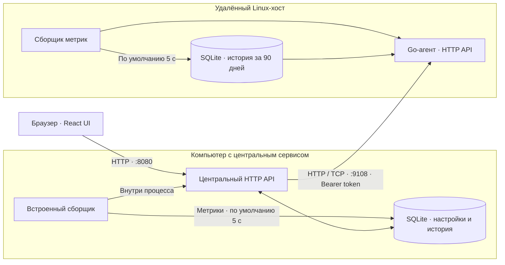
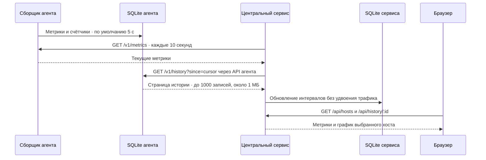
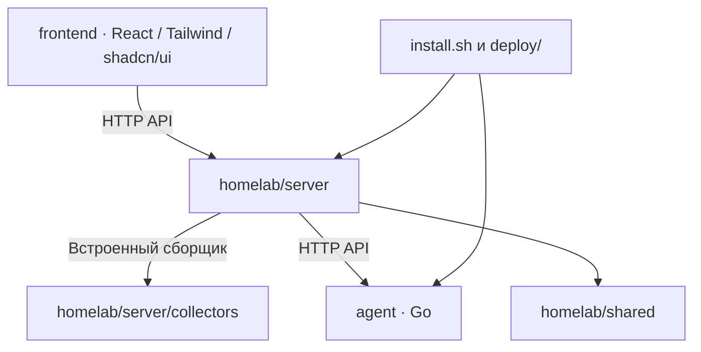

# Архитектура

Один компьютер обслуживается центральным сервисом со встроенным сборщиком. Отдельный агент и дополнительный сетевой порт на этой машине не нужны. Для других Linux-машин устанавливается самостоятельный агент.

При запуске в контейнере встроенный сборщик видит доступные ему ресурсы. Для мониторинга физического оборудования агент устанавливается на хост.

## Опрос и синхронизация

История начинается с запуска сборщика на каждой машине. Агент продолжает сбор при отключённом центральном сервисе. После подключения сервис догружает пропуски, максимум четыре страницы (до 4000 записей) за один опрос. Новые агенты ограничивают размер страницы примерно 1 МБ и возвращают `has_more` для продолжения даже при количестве записей меньше 1000; старые ответы без этого поля поддерживаются. Повторная загрузка незавершённого пятиминутного интервала заменяет его, не удваивая трафик.

Средние значения хранятся по 5 минутам в течение 90 дней. Графики за сутки показывают эти интервалы, за 7, 30 и 90 дней — агрегаты по 6 часов. CPU, память, GPU и сетевые скорости агрегируются по доступным значениям с учётом числа измерений; объёмы трафика суммируются. Объёмы трафика считаются из разницы счётчиков интерфейсов. За время остановки самого сборщика данные отсутствуют.

## Границы компонентов

- `agent/`: самостоятельный Go-модуль; сбор метрик Linux, CLI, YAML, SQLite и HTTP API.
- `homelab/server/collectors/`: встроенный сбор центрального сервиса внутри процесса Python.
- `homelab/server/`: центральный API, конфигурация хостов, опрос, синхронизация и архив агента.
- `homelab/shared/`: SQLite и YAML центрального сервиса. Не импортирует агент или сервер.
- `frontend/`: интерфейс; на удалённых агентах не нужен.
- `deploy/`: установка и systemd-службы.

Архив агента содержит установщик и пример конфигурации. Установщик скачивает Go-бинарник из GitHub Releases; Python-код центрального сервиса и frontend на машину агента не копируются.

Интервалы выше — значения по умолчанию. Частоту сбора, отдельный опрос GPU/SMART, выбор интерфейсов и срок хранения меняет [YAML-конфигурация](configuration.md). Центральный опрос и обновление браузера сейчас выполняются раз в 10 секунд.

История дискового I/O хранится в отдельной таблице `disk_history` рядом с основной историей и передаётся вложенным полем `disk_io` в тех же интервалах. При повторной синхронизации интервал заменяется целиком, объёмы не удваиваются. Срок хранения и удаление хоста применяются к обеим таблицам.
