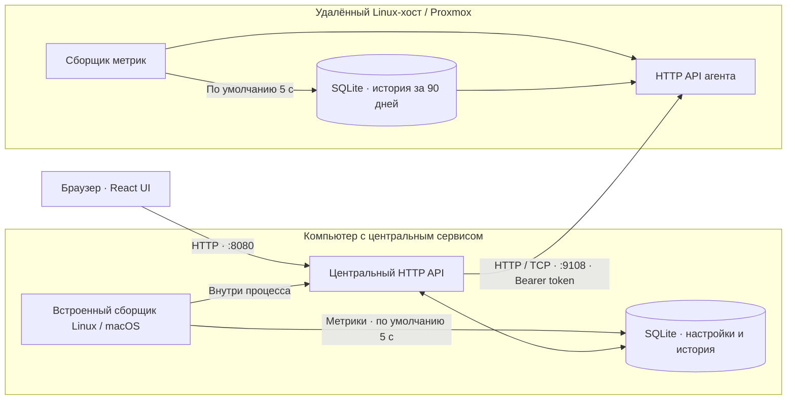
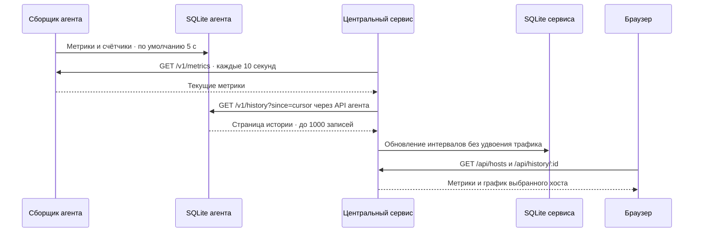
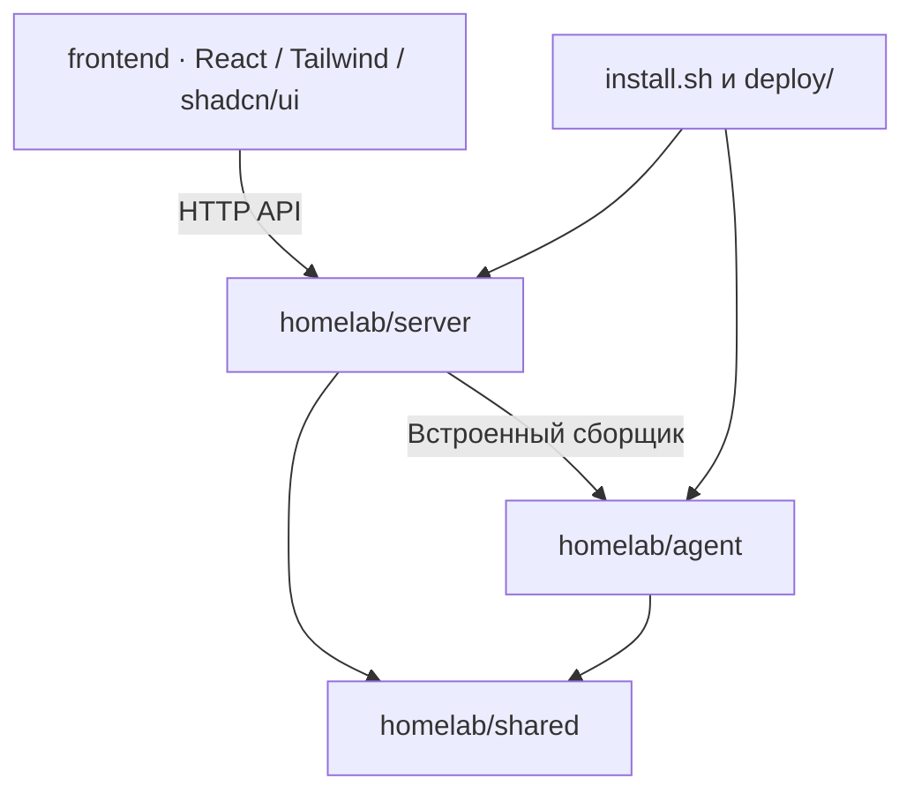

# Архитектура

Один Linux-компьютер или Mac обслуживается центральным сервисом со встроенным сборщиком. Отдельный агент и дополнительный сетевой порт на этой машине не нужны. Для других Linux-машин устанавливается самостоятельный агент.

В LXC встроенный сборщик видит контейнер. Для физического оборудования Proxmox устанавливайте агент на самом хосте.

## Опрос и синхронизация

История начинается с запуска сборщика на каждой машине. Агент продолжает сбор при отключённом центральном сервисе. После подключения сервис догружает пропуски, максимум 4000 записей за один опрос. Повторная загрузка незавершённого пятиминутного интервала заменяет его, не удваивая трафик.

Средние значения хранятся по 5 минутам в течение 90 дней. График за сутки показывает эти интервалы, за 90 дней — агрегаты по 6 часов. Объёмы трафика считаются из разницы счётчиков интерфейсов. За время остановки самого сборщика данные отсутствуют.

## Границы компонентов

- `homelab/agent/`: платформенные сборщики Linux/macOS, интервалы и HTTP API отдельного агента.
- `homelab/server/`: центральный API, конфигурация хостов, опрос, синхронизация и архив агента.
- `homelab/shared/`: SQLite и явный список файлов установочного пакета. Не импортирует агент или сервер.
- `frontend/`: интерфейс; на удалённых агентах не нужен.
- `deploy/`: установка и systemd-службы.

Архив отдельного агента содержит только `agent`, `shared` и установочные файлы. Его независимость от центрального сервиса проверяется тестами.

Интервалы выше — значения по умолчанию. Частоту сбора, отдельный опрос GPU/SMART, выбор интерфейсов и срок хранения меняет [YAML-конфигурация](configuration.md). Центральный опрос и обновление браузера сейчас выполняются раз в 10 секунд.
