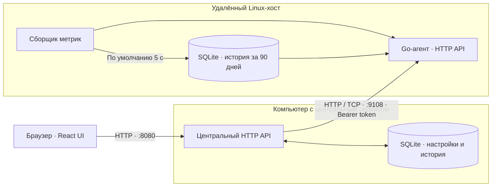
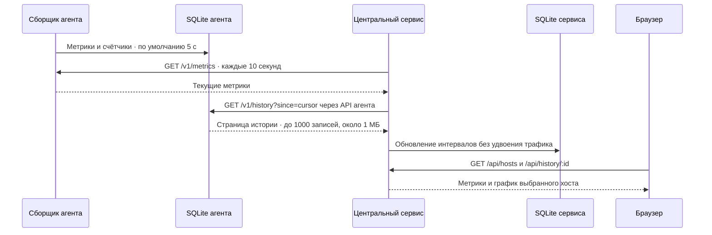
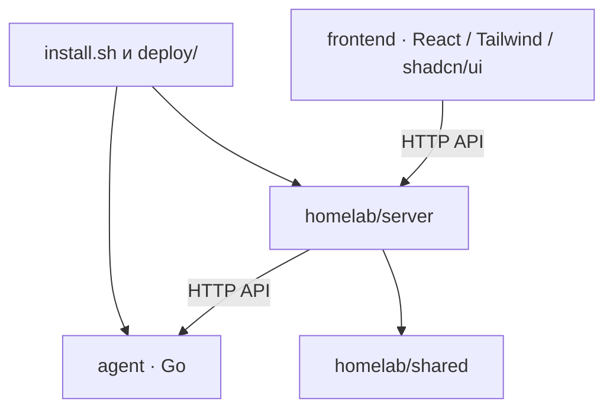

# Архитектура

Дашборд и Go-агент — отдельные процессы и systemd-службы. Дашборд не собирает оборудование и не запускает агент. Для каждого Linux-хоста, включая машину самого дашборда, агент устанавливается отдельно и подключается через тот же HTTP API. На одной машине можно использовать `127.0.0.1:9108`; у служб разные токены, конфигурация и базы. На Mac запускается только дашборд.

Дашборд может работать в контейнере без доступа к оборудованию. Агент в контейнере видит только доступные контейнеру ресурсы. Для мониторинга физического оборудования агент устанавливается на хост.

## Опрос и синхронизация

История начинается с запуска сборщика на каждой машине. Агент продолжает сбор при отключённом центральном сервисе. После подключения сервис догружает пропуски, максимум четыре страницы (до 4000 записей) за один опрос. Новые агенты ограничивают размер страницы примерно 1 МБ и возвращают `has_more` для продолжения даже при количестве записей меньше 1000; старые ответы без этого поля поддерживаются. Повторная загрузка незавершённого пятиминутного интервала заменяет его, не удваивая трафик.

Средние значения хранятся по 5 минутам в течение 90 дней. Графики за сутки показывают эти интервалы, за 7, 30 и 90 дней — агрегаты по 6 часов. CPU, память, GPU и сетевые скорости агрегируются по доступным значениям с учётом числа измерений; объёмы трафика суммируются. Объёмы трафика считаются из разницы счётчиков интерфейсов. За время остановки самого сборщика данные отсутствуют.

## Границы компонентов

- `agent/`: самостоятельный Go-модуль; сбор метрик Linux, CLI, YAML, SQLite и HTTP API.
- `homelab/server/`: центральный API, конфигурация хостов, опрос, синхронизация и архив агента.
- `homelab/shared/`: SQLite центрального сервиса. Не импортирует агент или сервер.
- `frontend/`: интерфейс; на удалённых агентах не нужен.
- `deploy/`: установка и systemd-службы.

Архив агента содержит установщик и пример конфигурации. Установщик скачивает Go-бинарник из GitHub Releases; Python-код центрального сервиса и frontend на машину агента не копируются.

Интервалы выше — значения по умолчанию. Частоту сбора, отдельный опрос GPU/SMART, выбор интерфейсов и срок хранения меняет [YAML-конфигурация](configuration.md). ATA SMART управляется отдельным суточным бюджетом с явным включением и списком серийных номеров; таблица `smart_cache` локального агента хранит последний успешный снимок и время попытки между перезапусками. Центральный опрос и обновление браузера сейчас выполняются раз в 10 секунд.

История дискового I/O хранится в отдельной таблице `disk_history` рядом с основной историей и передаётся вложенным полем `disk_io` в тех же интервалах. При повторной синхронизации интервал заменяется целиком, объёмы не удваиваются. Срок хранения и удаление хоста применяются к обеим таблицам.

## Переход со встроенного сборщика

Обновление дашборда прекращает встроенный сбор, сохраняя регистрацию удалённых агентов и их историю. Старые записи с ключом `local` остаются в SQLite в пределах срока хранения и доступны через `/api/history/local`; автоматического сопоставления с новым агентом нет, поскольку физическая идентичность прежнего локального хоста в этих записях не хранится. В UI прежний неявный локальный хост больше не появляется. Чтобы мониторить Linux-хост дашборда, установите и зарегистрируйте отдельный агент; он передаст свою сохранённую историю.

Старый `/etc/homelab/collector.yaml` сохраняется при обновлении, но не читается. Параметры `--no-self-monitor` и `--collector-config` принимаются для совместимости прежних команд запуска; сбор не включают. Настройки сбора задаются только в `/etc/homelab/agent.yaml`. Хранение центральной копии регулируется отдельно через `--retention-days` дашборда, по умолчанию 90 дней.
